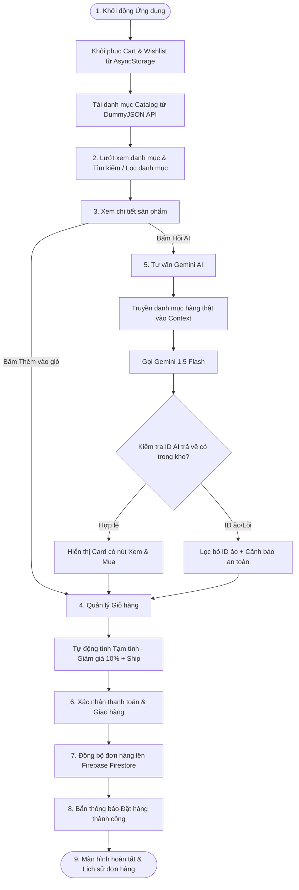

# REQUIREMENT TRACEABILITY MATRIX (RTM)

**Học phần:** MMA301 – Multiplatform Mobile App Development  
**Assignment:** 02 – Integrated E-Commerce Mobile App  
**Sinh viên:** Trần Minh Quân (CE181730)  
**Đề tài:** SmartShop Mobile E-Commerce Application  

---

## 1. Ma trận truy vết yêu cầu (Requirement Traceability Matrix)

| Mã YC | Tên Yêu Cầu | Thành phần UI / Code đảm nhận | Service / State / Layer | Test Case Tương Ứng | Trạng Thái |
| :--- | :--- | :--- | :--- | :--- | :--- |
| **R01** | **Remote Product Data** Tải catalog từ DummyJSON API | `src/screens/ProductListScreen.js` `src/components/ProductCard.js` | `src/api/productApi.js` `src/context/ProductContext.js` | TC01 (Success) TC02 (Offline/Retry) | ✅ Hoàn thành |
| **R02** | **FlatList + Pagination / Infinite** Phân trang cuộn tải vô tận | `src/screens/ProductListScreen.js` `ListFooterComponent` | `ProductContext.js` `loadMoreProducts()` (skip & limit guard) | TC04 (End of list & No duplicate) | ✅ Hoàn thành |
| **R03** | **Search / Filter + Refresh** Tìm kiếm từ khóa, danh mục & kéo làm mới | `src/screens/ProductListScreen.js` `RefreshControl`, Category chips | `ProductContext.js` `handleSearch()`, `handleCategorySelect()` | TC03 (Empty filter) TC05 (Search hit/miss) | ✅ Hoàn thành |
| **R04** | **Product Detail** Chi tiết sản phẩm, gallery, giá, kho hàng | `src/screens/ProductDetailScreen.js` Image carousel, Buy bar | `productApi.fetchProductById()` `route.params` | TC06 (Valid ID) TC07 (Missing/invalid ID) | ✅ Hoàn thành |
| **R05** | **Cart State** Thêm, tăng/giảm số lượng, xóa sản phẩm | `src/screens/CartScreen.js` `src/components/CartItemCard.js` | `src/context/CartContext.js` `addToCart()`, `updateQuantity()` | TC08 (Add same item) TC09 (Quantity 0 removal) | ✅ Hoàn thành |
| **R06** | **Derived Totals** Tính toán subtotal, giảm giá, phí ship, tổng tiền | `src/screens/CartScreen.js` `src/screens/CheckoutScreen.js` | `CartContext.js` Pure useMemo selectors (`totals`) | TC10 (0/1/many items calculation) | ✅ Hoàn thành |
| **R07** | **Persistence** Lưu trữ và khôi phục giỏ hàng khi khởi động lại | `App.js` `CartContext.js` | `src/services/storageService.js` `AsyncStorage (@smartshop_cart_v1)` | TC11 (Kill & restart app state) | ✅ Hoàn thành |
| **R08** | **Firebase Use Case** Đồng bộ đơn hàng đã đặt và Wishlist lên Cloud | `src/screens/CheckoutScreen.js` `src/screens/OrderHistoryScreen.js` | `src/services/firebaseService.js` `saveOrder()`, `fetchOrders()` | TC12 (Firebase write/read) TC13 (Cloud offline fallback) | ✅ Hoàn thành |
| **R09** | **Notification Flow** Xin quyền và kích hoạt thông báo sự kiện đơn hàng | `src/components/NotificationBanner.js` `src/screens/SettingsScreen.js` | `src/services/notificationService.js` `notifyOrderPlaced()`, `notifyFlashSale()` | TC14 (Permission allow/deny) TC15 (Order placed event) | ✅ Hoàn thành |
| **R10** | **Gemini AI Integration** Tư vấn mua sắm dựa trên kho hàng thực tế & validate | `src/screens/AIScreen.js` `src/components/ValidatedAICard.js` | `src/services/geminiService.js` `askShoppingAdvisor()`, `validateAndMatchOutput()` | TC16 (Valid recommendations) TC17 (Hallucinated ID filtering) | ✅ Hoàn thành |
| **R11** | **Debug Evidence** Bằng chứng tìm nguyên nhân gốc rễ và sửa 2 bug | `DEBUG_LOGS.md` Git commit history | `ProductContext.js` (onEndReached guard) `CartContext.js` (Price parsing) | TC18 (Infinite loop guard) TC19 (Total precision fix) | ✅ Hoàn thành |
| **R12** | **Release Build** Cấu hình standalone APK / build evidence | `app.json` `eas.json` (Release profile) | Standalone build config & assets | TC20 (Build verification) | ✅ Hoàn thành |

---

## 2. Business Workflow & Event Flow

